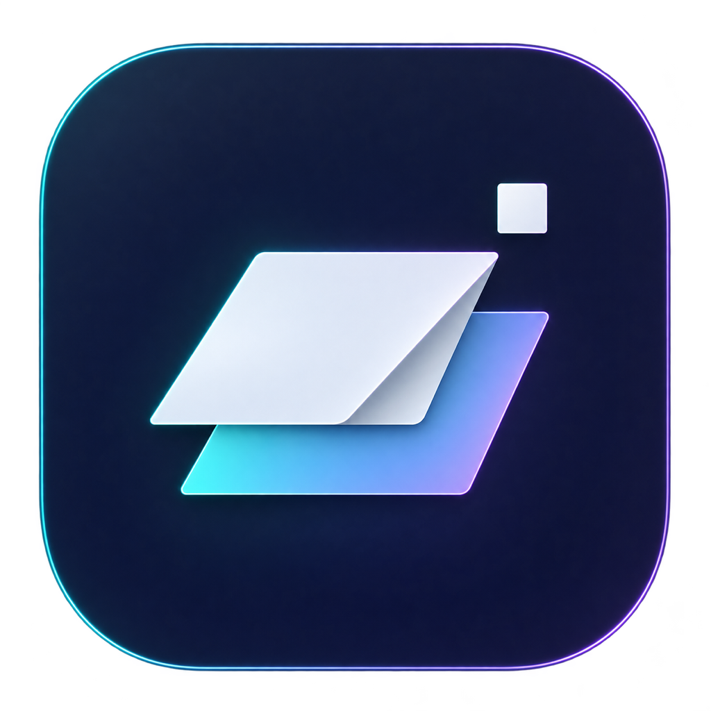

<div align="center">
  
  <h1>拾序 · Shixu</h1>
  <p>把零散的想法和会议记录，整理成接下来要做的事。</p>
  <p><a href="https://github.com/MUZI-LYY/shixu/releases/latest">下载 Mac 试用版</a> · <a href="docs/release-notes.md">版本说明</a></p>
</div>

拾序是以待办为中心、由 AI 辅助整理的 Mac 个人工作台。常驻屏幕顶部，通过文字、语音、录音和截图收集信息，先预览，再确认保存到待办或日历。

本地试用版本：**0.2.1**。本次交付为 **macOS 13+、Apple Silicon（arm64）**；构建与桌面检查环境为 macOS 15.1。暂不提供拾序的 Windows 或 Intel Mac 安装包。

## 能做什么

- **一句话处理事务**：新增、查询、改期或完成待办；简单中文表达可用本地规则，复杂表达使用配置的模型。结果先预览、逐条确认，支持本地操作记录与撤销。
- **两组录音快捷键**：语音待办按住说话、松开识别；会议录音按一次开始、再按一次结束。分别配置，默认关闭。
- **待整理**：临时想法、录音和会议结果先保存在这里，再转成待办或笔记。
- **会议整理**：从转写中提取摘要、明确决定、待确认问题和行动项，保留原文依据，确认后创建待办。
- **每日安排**：填写预计耗时，结合截止日期与日历，寻找连续空闲时段。采用确定性规则计算，建议确认后才写入日历。
- **Mac 日历**：默认按需创建「拾序」日历分类，也可选择已有可写日历。同一任务再次写入会更新关联事件，避免重复创建。
- **截图识字与翻译**：Apple Vision 本地 OCR，支持框选、图片文件、剪贴板图片；原文可编辑、复制，配置模型后可译为中文。
- **保留个人工具**：待办、笔记、链接、录音、随笔、音乐、番茄钟、当前窗口、镜子与密钥。首页以待办为主，密钥和设置位于右上角。

界面保持暗色，应用图标采用深色发光叠页造型。镜子默认显示中性摄像头占位图，只有主动点击才开启摄像头。

## 安装与升级

1. 在 [Releases](https://github.com/MUZI-LYY/shixu/releases/latest) 下载 `Shixu-0.2.1-arm64.dmg`。
2. 打开 DMG，将「拾序」拖入「应用程序」。`.sha256` 文件用于校验完整性，不是安装包。
3. 点击屏幕顶部入口展开；原面板也支持鼠标移到顶部入口后按空格。面板唤出与录音快捷键分别设置。

本版采用本地 ad-hoc 签名，未 Apple 公证。若首次被 macOS 阻止，请在「系统设置 → 隐私与安全性」查看「仍要打开」。

升级时先退出旧「事务工作台」或「拾序」。本版沿用 App ID 和数据目录，已有数据不因产品更名而迁移：

```text
~/Library/Application Support/Mac Voice Workspace/
```

任务、笔记、录音与设置保存在本机。系统加密的 API Key 在更换签名或电脑后可能需要重新输入。原 TO-DO Panel 的独立数据目录不由本应用自动覆盖。

## 快速开始

### 文字与语音待办

首页输入「明天交房租；健身」，点击「理解并预览」，检查后确认。没有日期的助手任务保持无截止时间；旧手动新增页面仍保留原有日期行为。

点击「说一句」使用百炼实时转写，也可以使用 macOS 系统听写向输入框输入文字。

右上角设置 →「语音与录音快捷键」：点击输入框后按下组合键，勾选启用并保存。建议组合：

| 动作 | 建议组合 | 方式 |
|---|---|---|
| 语音待办 | Control + Option + Space | 按住开始，松开结束；单段上限 2 分钟 |
| 会议录音 | Control + Option + R | 按一次开始，再按一次结束保存 |

组合可使用 Command / Control / Option，加字母、数字、Space 或 F1–F12，也可附加 Shift。快捷键冲突或权限不足时提示并保留有效旧配置。

### 会议整理与每日安排

同一个主助手使用两套明确的工作流，不运行多个独立后台 Agent。

- **会议整理**：首页点击「会议整理」粘贴转写，或从录制详情进入。核对摘要与行动项，编辑标题、负责人和截止日期，再确认加入个人待办。结果也保存到待整理。
- **每日安排**：选择日期、工作时段和未完成任务，填写每项预计耗时，读取日历生成预览。没有足够时间或任务已逾期时，说明原因，不自动压缩耗时。
- **加入日历**：任务行点击「日历」，明确开始/结束时间或主动勾选全天事项，选择目标日历后确认。保存实际执行时间，不改变任务截止日期。

## 配置与权限

首页「API 设置」配置服务：

| 能力 | 所需配置 |
|---|---|
| 实时语音转写 | 阿里云百炼 API Key 与对应地域 |
| 复杂事务理解、会议整理、翻译 | OpenAI-compatible Base URL、模型名称、API Key |
| 简单文字解析、笔记、本地 OCR | 不需要模型 Key |

API Key 通过系统安全存储加密。云转写会发送录音音频到百炼；会议整理与模型理解会发送必要文本和待办上下文到你配置的服务；翻译发送识别/编辑后的文字。**本地存储不代表模型功能完全离线**。服务费用由所选账户承担。

按使用功能授予系统权限：

- **输入监控**：全局录音快捷键；授权后在设置重新启用，必要时重启。系统列表可能显示拾序或 `workspace-native`。
- **麦克风**：主动录音。
- **屏幕录制**：框选截图。
- **日历**：读取忙碌时段、确认写入安排。
- **摄像头**：点击镜子时开启，离开首页或收起后释放。
- **辅助功能/自动化**：原有窗口聚焦和部分播放器控制。

不需要一次授予全部权限；文字待办和笔记可先使用。

## 当前边界

- 日历为**显式单向写入与改期**。完成、删除或撤销本地待办不会自动删除日历事件；Mac 日历中的改动不会反向更新任务。关联事件被删除或归属异常时会提示，不擅自覆盖其他日程。
- 录音采集**麦克风输入**，尚未实现独立系统音频捕获。在线会议戴耳机时，远端声音可能不在录音里。
- 没有 Apple 提醒事项同步、统一搜索、项目关联、说话人分离或自动多流程连续规划。
- 长会议目前为单次模型请求，没有自动分段合并；格式校验和原文引用不能替代人工确认。
- 模型、音频设备和日历账户的新流程测试使用模拟。真实语音质量、实体快捷键、权限和真实日历账户效果仍需配置后实测。

## 从源码运行

需要 Node.js 22.13+、npm，以及 macOS Command Line Tools。原生桥使用 Objective-C / clang、Apple Vision 与 EventKit。

```sh
git clone https://github.com/MUZI-LYY/shixu.git
cd shixu
npm ci
npm start
```

| 命令 | 用途 |
|---|---|
| `npm test` | Node 检查、原有 Electron 回归与语法检查 |
| `node scripts/run-shixu-check.js` | 新工作流 UI / IPC / 重启检查，模型、音频、日历为模拟 |
| `node scripts/run-assistant-check.js` | 事务操作、真实本地 OCR 与剪贴板验收 |
| `npm run build:native` | 编译并本地签名原生桥 |
| `npm run pack` | 生成本地 `.app` |
| `npm run build` | 生成 Apple Silicon DMG，不自动上传 |

Electron 桌面检查需要可用的 macOS 桌面环境。自动化测试使用隔离 profile，不应把个人日历或真实录音当作测试数据。

发布流程由匹配 `package.json` 的 `v*.*.*` 标签触发；CI 检查后构建并校验 Mac DMG，发布安装包与 SHA-256。手动 workflow 运行用于验证，不直接发布。`website/` 保留网站源码，是否部署由仓库设置与单独部署动作决定，不能视为已经在线。

## 实现结构

```text
main.js / preload.js          桌面主进程与安全 IPC
main/assistant.js            事务、模型、OCR 与日历读取
main/workflows.js            会议整理 / 每日安排调度
main/calendar.js             日历关联、幂等写入
main/voice-shortcuts.js       全局按键与配置
renderer/                    暗色界面、本地任务和工作流交互
native/WorkspaceNative.m     OCR、EventKit、按键监听原生桥
scripts/ / tests/            构建与验证
third_party/                 来源、许可证与归属
```

## 开源来源与许可证

拾序基于 [xiaopu-ai/TO-DO-Panel](https://github.com/xiaopu-ai/TO-DO-Panel) 的 Electron 桌面工作台改造，保留原项目 [MIT LICENSE](LICENSE) 与作者归属。

- [Innate-Labs/v2do](https://github.com/Innate-Labs/v2do)：参考并移植当前时间注入、多任务拆分、无时间不补造与结构化提取方法，MIT。未移植其要求更高系统版本的 SpeechAnalyzer。
- [schappim/macOCR](https://github.com/schappim/macOCR)：复用 Apple Vision OCR 流程，MIT。
- Easydict、Pot 仅用于前期功能调研，未复制代码。

完整来源见 [third_party/NOTICE.md](third_party/NOTICE.md)。上游历史介绍保存在 [docs/upstream-readme.md](docs/upstream-readme.md)，其下载、版本和平台承诺不代表拾序。
